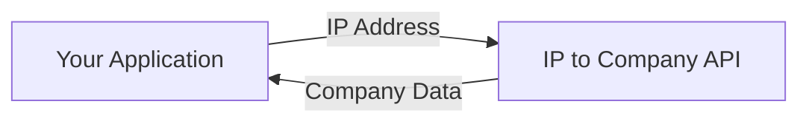

> ## Documentation Index
> Fetch the complete documentation index at: https://docs.snitcher.com/llms.txt
> Use this file to discover all available pages before exploring further.

# Introduction

> Turn any IP address into company intelligence with the Snitcher IP to Company API. Real-time company identification for B2B applications.

> [!WARNING]
>
> **Please Note:** The IP to Company API is a standalone offering and is not included with our standard product plans. If you'd like to purchase or learn more,
> please answer a few quick questions so our team can reach out.

## What is IP to Company?

**IP to Company is a real-time API that identifies which company an IP address belongs to.** Send us an IP address, and we'll return detailed firmographic data including company name, industry, size, location, and social profiles.

Use it to enrich your application with company intelligence—personalize experiences, qualify leads, route support tickets, or power your own visitor identification features.

### Key Use Cases

> **Website Personalization**
>
> Customize landing pages, CTAs, and content based on the visitor's company, industry, or size—in real-time.

> **Lead Enrichment**
>
> Automatically append company data to form submissions, signups, or support tickets.

> **Sales Intelligence**
>
> Power your own dashboards with company identification for website analytics or CRM enrichment.

> **Fraud Detection**
>
> Verify that business visitors are who they claim to be by matching IP data against company records.

***

## How It Works

The API is simple: send an IP address, receive company data.



### Single Request, Rich Response

```bash theme={null}
curl -X POST 'https://api.snitcher.com/company/find?ip=203.0.113.42' \
  -H 'Authorization: Bearer YOUR_API_KEY' \
  -H 'Accept: application/json'
```

When we identify a company, you'll receive:

| Data | Example |
| - | - |
| **Company Name** | Acme Corporation |
| **Domain** | acme.com |
| **Industry** | Information Technology |
| **Employee Range** | 50-200 employees |
| **Annual Revenue** | $10M - $50M |
| **Location** | San Francisco, CA, USA |
| **LinkedIn** | linkedin.com/company/acme |

> [!TIP]
>
> The API returns a `type` field indicating whether the IP belongs to a `business`, `isp`, or other network type—so you can handle each case appropriately.

### Two Ways to Identify

You can look up a company by **IP address**, or—if you also run [Radar](https://docs.snitcher.com/powered-by-snitcher/radar/introduction.md)—by a visitor's **session ID** for a higher match rate. See the [Quickstart](https://docs.snitcher.com/powered-by-snitcher/ip2company/quickstart.md#input-methods) for both input methods and when to use each.

***

## Why Snitcher?

Our IP intelligence database is the same one that powers the Snitcher platform, trusted by thousands of B2B companies for visitor identification.

* **Comprehensive coverage**: Continuously updated database of business IP ranges worldwide
* **Fast response times**: Built for real-time use cases with low-latency responses
* **Detailed firmographics**: Not just company name—get industry, size, revenue, location, and social profiles
* **Simple integration**: RESTful API with straightforward authentication

***

## Getting Started

> **[API Quickstart](https://docs.snitcher.com/powered-by-snitcher/ip2company/quickstart.md)**
>
> Authentication, endpoints, and example requests

> **[Reference Tables](https://docs.snitcher.com/reference/company-industries.md)**
>
> Industry categories, company sizes, and country codes


This documentation is built and hosted on [Mintlify](https://mintlify.com), a developer documentation platform.