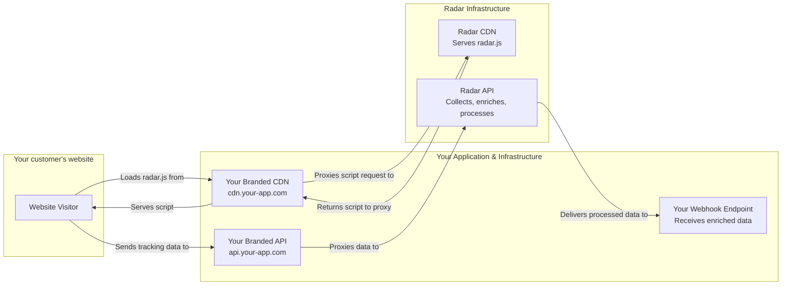

> ## Documentation Index
> Fetch the complete documentation index at: https://docs.snitcher.com/llms.txt
> Use this file to discover all available pages before exploring further.

# Introduction

> Radar: Powerful, Whitelabeled Web Tracking

> [!WARNING]
>
> **Please Note:** Radar is a standalone offering and is not included with our standard product plans. If you'd like to purchase or learn more about Radar, please reach out to
> support.

## What is Radar?

Imagine adding powerful **Visitor ID** and **Intent Signals** to your own software product. Your customers could see which companies are visiting their websites and understand user behavior, all from within your application and under your brand.

Building this from scratch is a massive undertaking, diverting your engineers from your core product for months. **Radar is the engine that powers these features for you.**

For nearly a decade, Snitcher has built advanced web tracking systems to power our own platform. With Radar, we've packaged that same battle-tested infrastructure into a flexible, scalable, and fully brandable solution you can drop into your own product in days, not months.

### Key Outcomes for Your Business

> **Increase Product Stickiness**
>
> Offer valuable analytics features that make your product indispensable to your customers.

> **Create New Revenue Streams**
>
> Monetize visitor identification and behavioral analytics as a premium add-on to your existing plans.

> **Accelerate Your Roadmap**
>
> Launch analytics and intent features in weeks, not years, and focus your engineers on what makes your product unique.

***

## Why Use Radar? It Solves the Hard Problems.

Radar helps you go to market fast with a highly reliable, fully managed backend that you can present as your own.

* **Offer Powerful Analytics, Instantly:** Provide your customers with automatic tracking for sessions, form submissions, and clicks without any complex setup on their part.
* **Maintain Your Brand Integrity:** Radar is completely invisible to your customers. All tracking scripts and data endpoints are served from your own domains.
* **Eliminate Maintenance Headaches:** We handle the complexities of browser changes (like ITP), evolving privacy laws (GDPR/CCPA), and infrastructure scaling so your team can focus.
* **You Control the Data Flow:** We stream raw events or fully processed sessions to **your webhook endpoint**. You can then process this data and display it in your application however you choose.

***

## The Build vs. Buy Trade-off

For most companies, the decision to build a system like this comes down to one question: "Is this the best use of our engineering resources?" Building a tracking system distracts your team from your core product, and the ongoing maintenance is a permanent tax on your roadmap.

| **Consideration** | **Build In-House** | **With Radar** |
| - | - | - |
| **Time to Launch** | 6–12 months | \< 1 week |
| **Initial Dev Cost** | 1000+ engineering hours | Zero |
| **Ongoing Maintenance** | Constant updates for browsers & privacy laws | Fully managed by Snitcher |
| **Infrastructure & Ops** | Your responsibility to scale, secure, and operate | Auto-scaled, secure, and operated by us |
| **Core Product Focus** | Diverted to building and maintaining a secondary product | Your team stays focused on what makes your product great |

For your technical team, consider the scope of a home-grown solution:

* **You'll need to build** a tracker, event pipeline, enrichment engine, and privacy layer—just to get started.
* **You'll need to constantly adapt** to browser quirks, cookie rules, and evolving compliance laws (GDPR, CCPA).
* **Every update** to this secondary system adds risk and technical debt, pulling resources from your main product.

***

## How It Works

Using Radar is simple. You provide the wrapper—Radar does the heavy lifting.



**1. 1. Generate a Tracker**

Use our API to generate a unique tracking script configuration for each of your customers.

**2. 2. Provide the Script**

Your customer installs a small JavaScript snippet on their website. All network requests are proxied through your branded domains.

**3. 3. Receive the Data**

Radar immediately begins tracking user behavior and streams the data to your webhook endpoint in real-time.

***

## A Peek Under the Hood

The Radar loader handles it all:

* Automatically updates the SDK
* Circumvents ITP and browser restrictions
* Routes requests through your domain for 1st-party compliance
* Configurable features: form tracking, click tracking, session tracking, and more. See the full [Configuration Reference](https://docs.snitcher.com/powered-by-snitcher/radar/configuration.md).

```javascript theme={null}
!(function (e) {
  "use strict";
  var a = e && e.namespace;
  if (a && e.profileId && e.cdn) {
    var r = window[a];
    if (((r && Array.isArray(r)) || (r = window[a] = []), !r.initialized && !r._loaded))
      if (r._loaded) console && console.warn("[Radar] Duplicate initialization attempted");
      else {
        r._loaded = !0;
        [
          "track",
          "page",
          "identify",
          "company",
          "group",
          "alias",
          "ready",
          "debug",
          "on",
          "off",
          "once",
          "trackClick",
          "trackSubmit",
          "trackLink",
          "trackForm",
          "pageview",
          "screen",
          "reset",
          "register",
          "setAnonymousId",
          "addSourceMiddleware",
          "addIntegrationMiddleware",
          "addDestinationMiddleware",
          "giveCookieConsent",
          "denyCookieConsent",
        ].forEach(function (e) {
          var i;
          r[e] =
            ((i = e),
            function () {
              var e = window[a];
              if (e.initialized) return e[i].apply(e, arguments);
              var r = [].slice.call(arguments);
              return r.unshift(i), e.push(r), e;
            });
        }),
          (r.bootstrap = function () {
            var a = document.createElement("script");
            (a.async = !0),
              (a.type = "text/javascript"),
              (a.id = "__radar__"),
              (a.dataset.settings = JSON.stringify(e)),
              (a.src = "https://"+e.cdn+"/releases/latest/radar.min.js");
            var r = document.scripts[0];
            r.parentNode.insertBefore(a, r);
          }),
          r.bootstrap();
      }
  } else "undefined" != typeof console && console.error("[Radar] Configuration incomplete");
})({
  cdn: "cdn.your-domain.com",
  apiEndpoint: "api.your-domain.com",
  profileId: "TRACKING-SCRIPT-ID",
  namespace: "YourApp",
});
```

***

## Deployment: Branding the Radar Experience

To make Radar feel native to your product, you'll configure:

### CDN Proxy

Host the tracking SDK under your brand (cdn.your-domain.com) by setting up a cloud proxy (like AWS CloudFront) pointing to cdn.snitcher.com.

### API Proxy

Send tracking data through your own API hostname (api.your-domain.com) via another cloud proxy for radar.snitcher.com.

***

## Rate Limits

The Radar Operator API enforces the following rate limits to ensure platform stability:

* **60 requests per minute** (per API token)

When you exceed the rate limit, the API will return an `HTTP 429 Too Many Attempts` response. Implement exponential backoff in your application to handle rate limiting gracefully.

> [!NOTE]
>
> Higher rate limits can be configured on your account upon request. Contact support if you need increased throughput for your Radar integration.

***

## Built for Builders. Backed by Snitcher.

Radar combines the power of enterprise-grade tracking with the flexibility of a drop-in SDK. Whether you're trying to offer analytics to your own customers, build a new data product, or integrate behavioral insights into your platform, Radar gets you there without the infrastructure tax.

Start with one customer. Scale to millions. Radar handles the rest.


This documentation is built and hosted on [Mintlify](https://mintlify.com), a developer documentation platform.