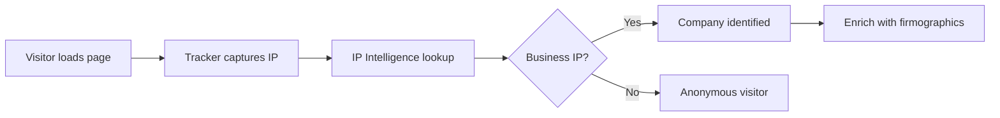
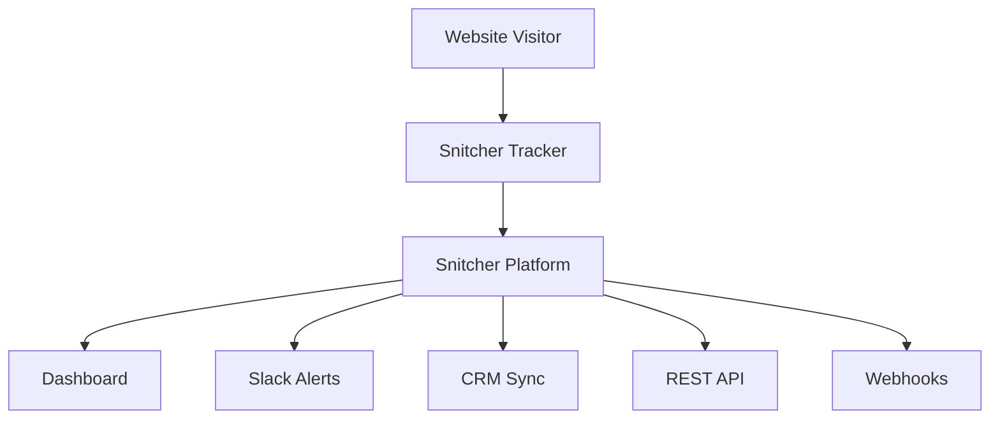

> ## Documentation Index
> Fetch the complete documentation index at: https://docs.snitcher.com/llms.txt
> Use this file to discover all available pages before exploring further.

# How Snitcher Works

> Snitcher uses IP intelligence to identify companies and first-party tracking to identify users visiting your website. Learn how the technology works.

**Snitcher identifies companies visiting your website using IP intelligence and tracks individual users through first-party cookies.** When a visitor loads your page, Snitcher captures their IP address and matches it against a proprietary database of business networks to reveal the company. When users provide their email (via forms, login, or tracked links), Snitcher links their entire browsing history to that identity.

## Data Collection

Snitcher collects data via a lightweight JavaScript tracker installed on your website. Most companies install it on their:

* Marketing website
* Blog and content pages
* Documentation / help center
* Application (for product usage signals)

The tracker automatically captures:

* **Pageviews**: Every page visited, including time on page
* **Sessions**: Grouping activity into browsing sessions
* **Referrers**: Where visitors came from (Google, LinkedIn, email campaigns, etc.)
* **UTM Parameters**: Campaign tracking data
* **Device Info**: Browser, operating system, screen size
* **Form Submissions**: When enabled, captures form interactions

> [!NOTE]
>
> The tracker is asynchronous and lightweight (\~15KB gzipped). It won't slow down your website.

## Company Identification

When a visitor loads your website, Snitcher attempts to identify their company:



### How IP Intelligence Works

Snitcher maintains a comprehensive database mapping IP addresses to companies. When we detect a visitor:

1. We look up their IP address in our database
2. If matched to a business, we return company information:
   * Company name and domain
   * Industry and employee count
   * Headquarters location
   * Social profiles (LinkedIn, etc.)
3. The visitor's session is associated with that company

> [!NOTE]
>
> IP-based identification works at the **company level**, not the individual level. We can tell you "someone from Acme Corp visited your pricing page" but not specifically who—until they identify themselves.

### What About ISPs and VPNs?

Not every IP can be identified:

* **Consumer ISPs** (Comcast, Verizon, etc.) are shared by millions of households
* **VPN services** mask the visitor's true location
* **Mobile networks** use carrier IPs shared across users

When we can't identify a company, the visitor appears as "Anonymous" with their approximate location based on IP geolocation.

## User Identification

While IP intelligence reveals companies, **user identification** reveals specific people. This happens when visitors provide their email address:

* Filling out a form (demo request, newsletter signup, content download)
* Logging into your application
* Clicking a tracked email link
* Being identified via your code using `Snitcher.identify()`

```javascript theme={null}
// When a user logs in
Snitcher.identify("sarah@acme.com", {
  name: "Sarah Chen",
  role: "VP Marketing"
});
```

Once identified, the visitor's **entire session history**—including anonymous activity before identification—is linked to their profile.

### Cross-Session Identification

Snitcher uses first-party cookies to maintain identity across sessions:

1. First visit: Anonymous visitor from Acme Corp
2. Second visit: Still anonymous, but same device ID
3. Form submission: Visitor identified as [sarah@acme.com](mailto:sarah@acme.com)
4. **All three sessions are now linked** to Sarah

This means you see the complete buyer journey, from first touch to conversion.

## Data Flow to Your Tools

Once collected, Snitcher data flows to your sales and marketing stack:



* **Dashboard**: View identified companies, sessions, and user activity
* **Slack Alerts**: Get notified when target accounts visit key pages
* **CRM Sync**: Push companies and contacts to Salesforce, HubSpot, etc.
* **REST API**: Query data programmatically
* **Webhooks**: Trigger workflows in external systems

## FAQ

> **How does Snitcher know which companies are on my site?**
>
> Snitcher uses IP intelligence to match visitor IP addresses to companies. We maintain a proprietary database of business IP ranges, updated continuously. When a visitor comes from a known business IP, we identify the company and enrich it with firmographic data.

> **How does Snitcher detect known users?**
>
> When users identify themselves on your website (submit a form, log in, etc.), Snitcher captures their email address and associates it with their browser session. This often happens automatically via form tracking, or you can call `Snitcher.identify()` manually.
>
> Snitcher handles profile merging automatically—if the same person visits from multiple devices, we unify their activity once they identify on each device.

> **Does Snitcher work with single-page applications (SPAs)?**
>
> Yes. The tracker automatically detects client-side navigation (History API, hash changes) and tracks pageviews without additional configuration.

> **What about GDPR and privacy compliance?**
>
> Snitcher uses only first-party data and does not rely on third-party cookies. For GDPR compliance, you should:
>
> * Disclose Snitcher in your privacy policy
> * Integrate with your cookie consent manager (we support all major CMPs)
> * Use the `waitForConsent` configuration option
>
> See our [Cookie Consent guide](https://docs.snitcher.com/product/tracker/cookie-consent.md) for details.

> **How accurate is company identification?**
>
> Accuracy depends on the visitor's network:
>
> * **Office networks**: Very high accuracy—most businesses have dedicated IP ranges
> * **Corporate VPN**: High accuracy when traffic routes through company infrastructure
> * **Residential networks**: Company identification is limited, but [user identification](https://docs.snitcher.com/product/identity-layer.md) fills this gap when visitors provide their email
> * **Mobile networks**: Company identification is limited—consider using [email link tracking](https://docs.snitcher.com/product/tracker/identify-email-recipients.md) to identify these visitors

> **Does Snitcher slow down my website?**
>
> No. The tracker loads asynchronously and is highly optimized (\~15KB gzipped). It has no impact on your Core Web Vitals or page load time.

## Next Steps

> **[Install the Tracker](https://docs.snitcher.com/product/tracker/installation.md)**
>
> Get started in minutes

> **[Identity Layer](https://docs.snitcher.com/product/identity-layer.md)**
>
> Deep dive into user identification


This documentation is built and hosted on [Mintlify](https://mintlify.com), a developer documentation platform.